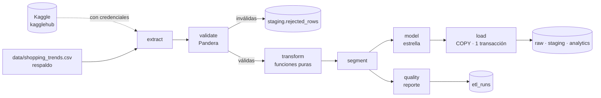

# Shopping Insights · ETL

ETL en Python del proyecto **Shopping Insights**: extrae el dataset
[Customer Shopping Trends](https://www.kaggle.com/datasets/iamsouravbanerjee/customer-shopping-trends-dataset),
lo valida con contratos Pandera, lo transforma con Polars, segmenta a los clientes y lo carga en
PostgreSQL en tres capas (`raw → staging → analytics`) dentro de **una sola transacción**.

El proyecto ocupa tres repositorios:

| Repo | Contenido |
|---|---|
| **`shopping-insights-etl`** (este) | ETL: extracción, validación, transformación y carga |
| [`shopping-insights-api`](https://github.com/D4v13B/shopping-insights-api) | API, esquema y migraciones, roles de la base y Docker Compose del stack completo |
| [`shopping-insights-web`](https://github.com/D4v13B/shopping-insights-web) | Dashboard en TanStack Start + shadcn/ui |

> El esquema de la base lo define la API con Drizzle ([ADR 0006](https://github.com/D4v13B/shopping-insights-api/blob/main/docs/adr/0006-drizzle-dueno-del-esquema.md)).
> El ETL solo escribe datos, así que necesita una base ya migrada.

## Cómo funciona



- **Extracción**: descarga con `kagglehub` si hay credenciales; si no, o si falla, usa el CSV de
  respaldo versionado en `data/` (ver [`data/README.md`](data/README.md)).
- **Validación**: las filas inválidas van a `staging.rejected_rows` con su motivo en vez de
  detener la carga.
- **Carga**: `TRUNCATE` + `COPY` + `REFRESH MATERIALIZED VIEW` en una transacción: todo o nada e
  idempotente. Cada ejecución queda auditada en `etl_runs` con su reporte de calidad.
- **Worker**: `shopping-etl worker` escucha `NOTIFY etl_requested` (lo emite la API en
  `POST /api/v1/etl/run`) y ejecuta las solicitudes de una en una, con un advisory lock.

Detalle en [`docs/etl.md`](docs/etl.md), hallazgos del dataset en
[`docs/data-quality.md`](docs/data-quality.md) y decisiones en [`docs/adr/`](docs/adr/).

## Ejecutar con Docker (recomendado)

El ETL corre dentro del stack completo, que se levanta desde el repo de la API con los tres repos
clonados como carpetas hermanas:

```bash
git clone https://github.com/D4v13B/shopping-insights-etl.git
git clone https://github.com/D4v13B/shopping-insights-api.git
git clone https://github.com/D4v13B/shopping-insights-web.git

cd shopping-insights-api
cp .env.example .env
docker compose up --build
```

Compose construye la imagen de este repo y la usa en dos servicios: `etl` (carga inicial al
arrancar) y `etl-worker` (queda escuchando recargas).

La imagen también se puede construir sola: `docker build -t shopping-insights-etl .`

## Instalación y ejecución local

Requisitos: **Python 3.13**, **[uv](https://docs.astral.sh/uv/) 0.8** y un PostgreSQL ≥ 17 migrado
con los roles creados (paso 1 de "Desarrollo local sin Docker" en el README de la API).

```bash
uv sync
cp .env.example .env    # ajustar DATABASE_URL_ETL

uv run shopping-etl run       # ejecuta el ETL una vez
uv run shopping-etl worker    # queda escuchando solicitudes de la API
```

`shopping-etl run` termina con código `0` si la carga fue correcta, `2` si ya había otra ejecución en
curso y `1` ante cualquier otro error.

## Variables de entorno

Se validan al arrancar con pydantic-settings y se leen también de `.env`. Ver
[`.env.example`](.env.example).

| Variable | Obligatoria | Descripción |
|---|---|---|
| `DATABASE_URL_ETL` | Sí | Conexión como `etl_writer` |
| `KAGGLE_USERNAME`, `KAGGLE_KEY` | No | Sin ellas se usa el CSV de respaldo |
| `ETL_FALLBACK_CSV` | No | Ruta del CSV de respaldo (por defecto `data/shopping_trends.csv`) |
| `LOG_LEVEL` | No | Nivel de log (`info` por defecto) |
| `ETL_WORKER_POLL_SECONDS` | No | Sondeo de respaldo del worker además de `LISTEN` (30 s) |

## Calidad y pruebas

```bash
uv run ruff format --check . && uv run ruff check .   # formato y lint
uv run mypy                                           # tipos (strict)
uv run pytest --cov=shopping_etl                      # tests con cobertura
```

- **Unitarios**: extracción, validación, cada transformación, segmentación y modelo, en memoria.
- **Integración** (se activan con `TEST_DATABASE_URL_ETL` y `TEST_DATABASE_URL_ADMIN`): idempotencia,
  rollback ante fallo, ejecuciones huérfanas, worker y lock contra un Postgres real.
- 63 tests · 87 % de cobertura (`transform.py` 100 %). El ETL completo tarda unos 0.4 s con el CSV
  local.
- **CI** (GitHub Actions): Ruff, mypy, pytest contra un Postgres migrado (hace checkout de
  `shopping-insights-api` para aplicar sus migraciones) y build de la imagen. Si los repos son
  privados, el CI necesita el secreto `CROSS_REPO_TOKEN` con lectura sobre el repo de la API.

## Estructura

```
shopping-insights-etl/
├── src/shopping_etl/
│   ├── cli.py          # shopping-etl run | worker
│   ├── config.py       # Settings (pydantic-settings)
│   ├── extract.py      # Kaggle o CSV
│   ├── validate.py     # Contratos Pandera (schemas.py)
│   ├── transform.py    # Funciones puras
│   ├── segment.py      # Segmentación de clientes
│   ├── model.py        # Dimensiones y hechos
│   ├── quality.py      # Reporte de calidad
│   ├── load.py         # COPY transaccional
│   ├── runs.py         # Ciclo de vida de etl_runs
│   ├── pipeline.py     # Orquestación con advisory lock
│   └── worker.py       # LISTEN/NOTIFY
├── tests/
├── data/               # CSV de respaldo
├── docs/               # ETL, calidad de datos y ADRs
├── Dockerfile
└── pyproject.toml
```

## Limitaciones y mejoras futuras

- El dataset no tiene fechas y es sintético, con sesgos fuertes (ver
  [`docs/data-quality.md`](docs/data-quality.md)).
- Con fechas y volumen: carga incremental, tabla de hechos particionada y orquestación (Dagster o
  Prefect) con transformaciones en dbt.
