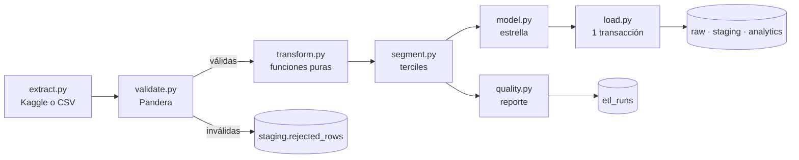

# ETL

Paquete Python `shopping_etl` (`src/shopping_etl`). Lo ejecuta la CLI `shopping-etl`.



| Módulo | Qué hace | Efectos secundarios |
|---|---|---|
| `extract.py` | Descarga con `kagglehub` si hay credenciales; si no, o si falla, lee `data/shopping_trends.csv`. Lee todo como texto y verifica las 19 columnas | Red / disco |
| `validate.py` | Numera las filas, recorta espacios, convierte tipos y valida con Pandera | Ninguno |
| `transform.py` | Limpieza y columnas derivadas | Ninguno (puras) |
| `segment.py` | Segmentación por reglas | Ninguno |
| `model.py` | Dimensiones y hechos con *surrogate keys* deterministas | Ninguno |
| `quality.py` | Reporte JSON de calidad de datos | Ninguno |
| `load.py` | `TRUNCATE` + `COPY` + `REFRESH` en una transacción | Base de datos |
| `runs.py` | Ciclo de vida de `etl_runs` | Base de datos |
| `pipeline.py` | Orquesta una ejecución con su advisory lock | — |
| `worker.py` | `LISTEN etl_requested`, recuperación y apagado ordenado | — |

Solo `extract` y `load` tocan el mundo exterior. Todo lo demás se prueba en memoria.

## Capas

| Capa | Tabla | Contenido |
|---|---|---|
| raw | `raw.shopping_trends` | El CSV tal cual, todo `text`, más `_run_id` y `_loaded_at`. Permite auditar qué llegó |
| staging | `staging.purchases` | Filas válidas, tipadas y con columnas derivadas |
| staging | `staging.rejected_rows` | `row_number`, `payload` (fila original en JSON) y `errors` (motivos) |
| analytics | `dim_*`, `fact_purchase` y vistas | Esquema estrella para consultar |

## Validación (contrato de entrada)

Se aplica sobre la entrada ya convertida a sus tipos (`schemas.py → InputSchema`). Una fila que
incumple cualquier regla se rechaza con todos los motivos que detecta Pandera, y el pipeline sigue.

| Columna | Regla |
|---|---|
| `customer_id` | Entero > 0, único |
| `age` | Entero entre 18 y 100 |
| `purchase_amount_usd` | Numérico > 0 |
| `review_rating` | Entre 1 y 5 |
| `previous_purchases` | Entero ≥ 0 |
| `gender` | `Male`, `Female` |
| `category` | `Clothing`, `Footwear`, `Outerwear`, `Accessories` |
| `season` | `Winter`, `Spring`, `Summer`, `Fall` |
| `size` | `S`, `M`, `L`, `XL` |
| `location` | Uno de los 50 estados de EE.UU. |
| `frequency_of_purchases` | Uno de los 7 valores conocidos |
| `subscription_status`, `discount_applied`, `promo_code_used` | `Yes`, `No` |
| Textos libres (producto, color, pago, envío) | No vacíos |

Un valor que no se puede convertir a número (por ejemplo, `age = "treinta"`) se rechaza como
`tipo numérico` en un paso previo; esas filas no pasan por Pandera, así que solo reportan sus errores
de tipo. Un fallo a nivel de archivo (faltan columnas) aborta la ejecución, porque no es un
problema de filas sueltas.

Ejemplo de fila rechazada:

```json
{
  "row_number": 2,
  "payload": { "customer_id": "2", "age": "17", "gender": "Other", "…": "…" },
  "errors": [
    { "column": "age", "check": "greater_than_or_equal_to(18)", "value": "17" },
    { "column": "gender", "check": "isin(['Male', 'Female'])", "value": "Other" }
  ]
}
```

## Transformaciones

| Paso | Antes | Después |
|---|---|---|
| Nombres | `Item Purchased`, `Purchase Amount (USD)`, `Location` | `item_name`, `amount_usd`, `state_name` |
| Booleanos | `"Yes"` / `"No"` | `true` / `false` |
| Promoción | `Discount Applied = Yes`, `Promo Code Used = Yes` | `promo_used = true` (OR). Se verifica y reporta que son idénticas |
| Frecuencia | `Fortnightly`, `Bi-Weekly` | `frequency_label = biweekly`, `frequency_days = 14`, `purchases_per_year = 26.07` |
| Frecuencia | `Quarterly`, `Every 3 Months` | `quarterly`, `90`, `4.06` |
| Edad | `age = 23` | `age_band = "18-24"` (18–24, 25–34, 35–44, 45–54, 55–64, 65+) |
| Ubicación | `Maine` | `state_code = ME`, `region = Northeast` (regiones del Census) |
| Valor | `amount_usd = 50`, `purchases_per_year = 12.17` | `estimated_annual_value = 608.50` |
| Historial | `previous_purchases = 9` | `lifetime_purchases = 10` |

La fuente única del mapeo estado → código → región es `reference.py`. El ETL también construye
`dim_location` a partir de ella, con los 50 estados aunque alguno no tenga ventas.

## Segmentación

Terciles de `estimated_annual_value` (V) y de `previous_purchases` (P). Las reglas se evalúan en orden
y gana la primera que se cumple (`segment.py → SEGMENT_RULES`):

| Orden | Segmento | Regla | Clientes |
|---|---|---|---|
| 1 | Campeones | V alto y P alto | 429 |
| 2 | Leales | P alto | 860 |
| 3 | En riesgo | P medio o alto y frecuencia anual o trimestral | 554 |
| 4 | Potenciales | V alto y P bajo | 432 |
| 5 | Ocasionales | Resto | 1,625 |

Umbrales con el dataset actual: V = 286.91 y 1,156.15 USD; P = 17 y 33 compras. Como no hay fechas,
"En riesgo" es un *proxy* (historial relevante con baja frecuencia), no una medida de recencia. Así se
explica en la UI.

## Carga, idempotencia y recuperación

1. `pg_try_advisory_lock` en una conexión de control: si otro proceso lo tiene, se aborta
   (`AlreadyRunningError`, código de salida 2).
2. Las filas que seguían en `running` se marcan como `failed`: con el lock tomado, son huérfanas.
3. Se adopta una solicitud `requested` pendiente o se crea una fila `running`.
4. Todo lo que no toca la base (extract → model → quality) se ejecuta en memoria.
5. En **una transacción**: `TRUNCATE` de las 8 tablas, `COPY` de cada una, `REFRESH` de las 3 vistas
   materializadas y `UPDATE etl_runs → success` con el reporte.
6. Si algo falla, rollback total y `UPDATE → failed` con el error, por la conexión de control.

Ejecutarlo N veces deja siempre el mismo estado. Lo verifica `tests/test_integration.py`, igual que el
rollback ante un fallo inducido en mitad del `COPY`.

## Modos de ejecución

```bash
uv run shopping-etl run                    # una vez (trigger = cli)
uv run shopping-etl run --trigger startup  # lo que hace el servicio etl de Docker
uv run shopping-etl worker                 # escucha NOTIFY etl_requested
```

El worker procesa las solicitudes pendientes al arrancar, tras cada `NOTIFY` y cada 30 segundos
(`ETL_WORKER_POLL_SECONDS`). Se reconecta con *backoff* exponencial (hasta 60 s) y ante `SIGTERM`
termina la ejecución en curso antes de salir.

## Logs

Una línea JSON por evento, con `run_id` enlazado:

```json
{"counts": {"raw.shopping_trends": 3900, "staging.purchases": 3900, "staging.rejected_rows": 0, "analytics.dim_customer": 3900, "analytics.dim_product": 25, "analytics.dim_location": 50, "analytics.dim_payment": 36, "analytics.fact_purchase": 3900}, "event": "carga_completa", "run_id": "410e93a7-…", "level": "info", "timestamp": "2026-10-19T20:14:01.601356Z"}
```
